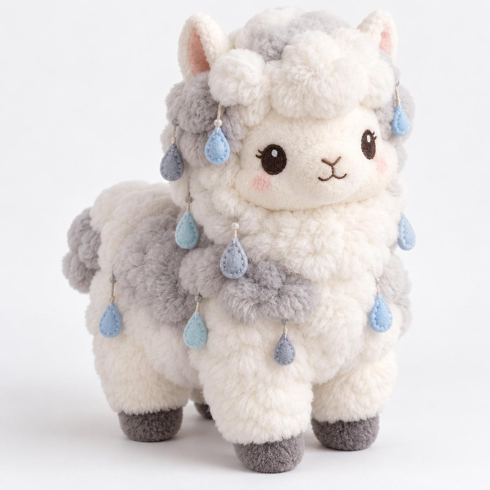
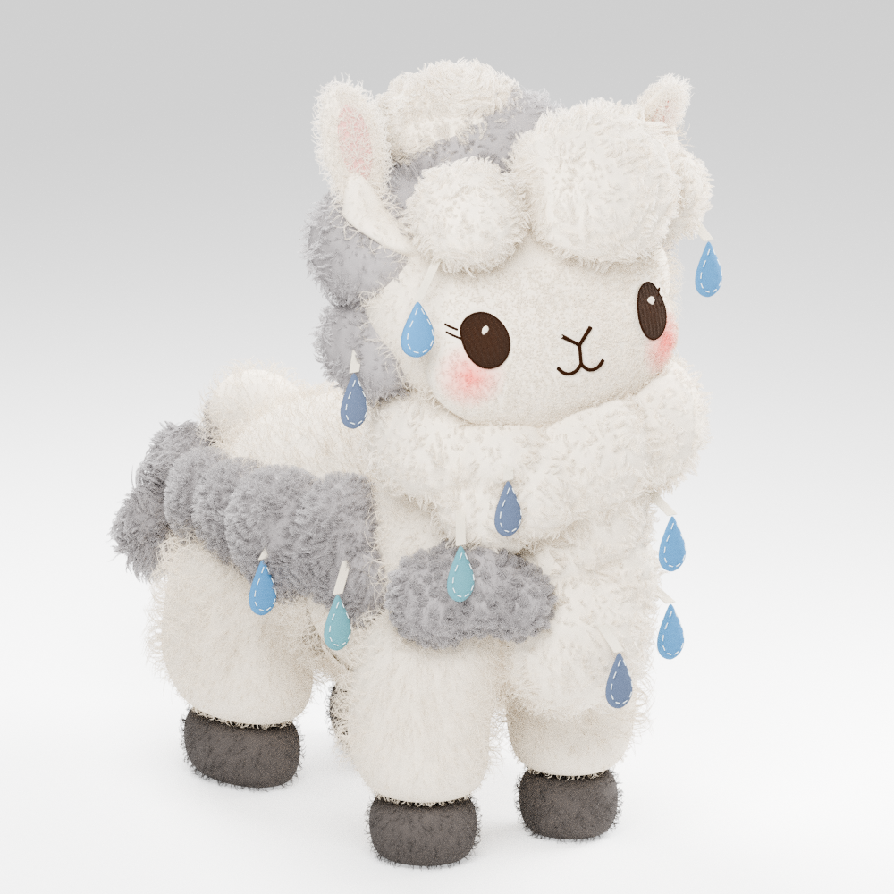

# 云朵羊驼原型参考图片（唯一开发仓库）

这四张 PNG 已实际迁入 `plush-pattern-lab`，后续无需从旧私有仓库找图。它们是**不同阶段的参考**，不是四张最终成品照片。

## 造型目标和被选中的外观

| 原始设计目标（约25 cm） | 选中 D 阶段的 Blender 外观 |
| --- | --- |
|  |  |
| 理想的二维视觉目标，不是可直接生产的纸样 | H 胸云＋E 侧云＋D 额云的历史选定候选；不是 Stage 6 四蹄增量的最终新渲染 |

## 供工程回归使用的历史对照

- [单蹄共享边界接缝 A/B](single-hoof-seam-comparison.png)：2026-10-22 的工程对照，不能当作四蹄全体最新外观。
- [单蹄毛根修整 A/B](single-hoof-fleece-comparison.png)：局部毛根处理，不能推断真实布料/填充已通过验证。

## 原件与安全校验

[manifest.json](manifest.json) 逐文件记录 SHA-256、Git blob SHA-1、尺寸、脱敏方法与必要的历史来源。迁移遵守以下约束：

- 原始设计剥离了一个不必要的 `caBX` 辅助块；D 阶段图剥离 EXIF、文本和其他非必需 PNG 辅助块。**原始 IDAT 像素压缩数据保持原字节**，未重新生成、拉伸或替换设计图。
- `tests/test_public_reference_images.py` 在本仓库内校验大小、SHA-256、Git blob 身份、PNG CRC 与元数据。无需接入旧私有仓库或在线鉴权。
- 这四份已列名的原创视觉资产采用 [CC BY 4.0](../../../ASSET_LICENSE.md)；既有七份 JSON/合同资料仍按 CC0，代码按 MIT。

**唯一剩余的原型核心二进制缺口**：Stage 6 可编辑四蹄模型 `cloud-alpaca-stage6.blend` 尚未进入本公开仓库。它不能用选中 D 渲染或合成椭球模拟替代。六份历史 ZIP 是独立的溯源/灾备事项，不是日常新功能的研发仓库。

[统一原型开发基线](../../../docs/原型开发基线.md) · [Issue #14](https://github.com/timlincool/plush-pattern-lab/issues/14)
